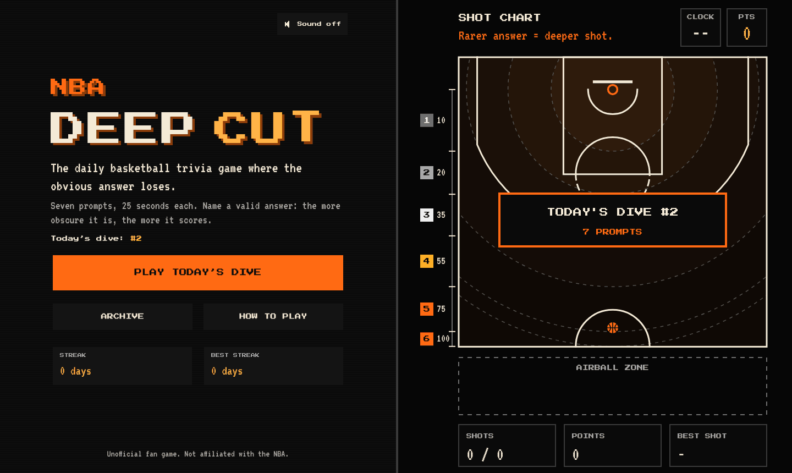
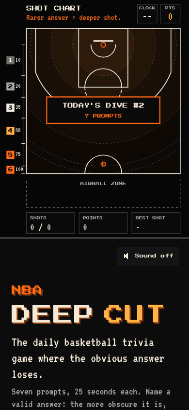
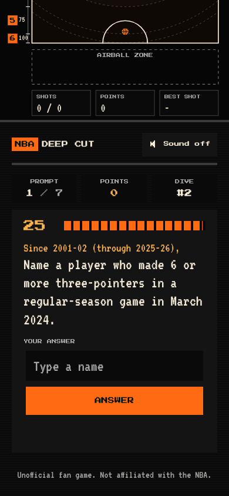
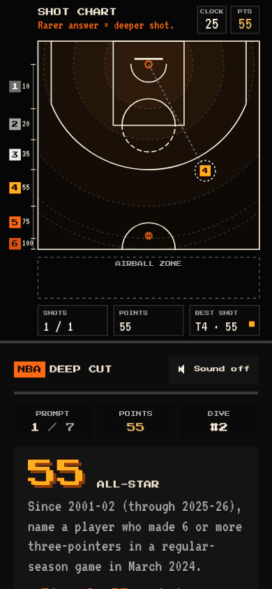
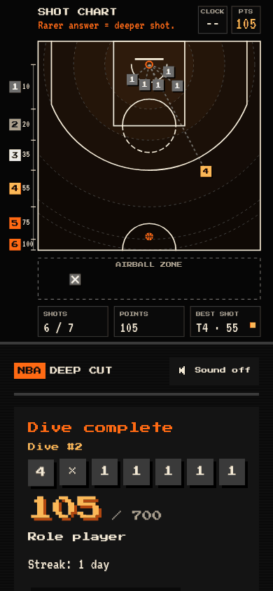

# Deep Cut

A daily basketball trivia game where the obvious answer loses. Every day there is a new **dive** of seven prompts, 25 seconds each, for example "Since 2001-02, name a player who played for both the Philadelphia 76ers and the Phoenix Suns". Name any valid answer: the more obscure it is, the more it scores. Share your total and seven colored squares.

It is a static website (Vite, React, TypeScript) with no backend, no accounts, no analytics and no cookies. The prompts come from an offline Python pipeline that turns real NBA box scores (2001-02 to 2025-26) into two JSON files.



| Phone: home | Phone: a prompt | Phone: a deep cut reveal | Phone: results |
| --- | --- | --- | --- |
|  |  |  |  |

On a screen 900 px wide or more the game is a split screen: the questions on the left, a flat top-down **shot chart** on the right. The deeper from the basket a marker lands, the rarer the answer: six zones, one per tier, with a depth gauge, a marker per answer, and an airball zone for wrong or late ones. On a phone the chart is above the questions. More screenshots at two sizes are in [docs/screenshots/chart](docs/screenshots/chart); [docs/design.md](docs/design.md) explains the design.

## How it plays

- **A dive** is 7 prompts, 25 seconds each. Type a name (autocomplete suggests from the whole list of players and teams, so it never gives an answer away) and press Enter.
- **Scoring** is by tier: 10, 20, 35, 55, 75 or 100 points for a valid answer, 0 for a wrong or late one. A dive is worth at most 700.
- **The reveal** sends a ball from the bottom of the chart to a marker in your tier's zone (rarer answers fly longer and land deeper; T6 earns a flash and a "DEEP CUT" stamp; a wrong or late answer falls short into the airball zone), then shows the most famous and the rarest valid answers. At the end all seven markers are on the chart, with a rank label for your total.
- **Streaks and the archive:** finish each day's dive to keep your streak; past dives are in the archive and do not count for the streak. Everything is kept in your browser (localStorage); there is no account.
- A real player from before 2001-02 gets an "outside the data range" message, not a miss.

## Run it

You need Node 20.19 or later (Node 22 works too).

```
cd web
npm install        # or npm ci
npm run dev        # http://localhost:5173
```

`npm run dev` first copies the pipeline's export into `web/public/` when `data/export/` exists (and says so when it does not). The three data files are committed in `web/public/`, so the site also runs from `web/` alone.

Other commands, all in `web/`:

| Command | What it does |
| --- | --- |
| `npm test` | the unit and integration tests (Vitest) |
| `npm run build` | type-check and build to `web/dist` |
| `npm run preview` | serve the production build locally |
| `npm run sync-data` | copy `data/export/*.json` and the outside-range list into `web/public/` |

Useful URLs while developing: `/?preview=1` shows a Play-test before launch, `/?preview=1&today=2026-11-10` pretends it is that day (with its own saved progress), and `/?animations=1` (development) or `/?preview=1&animations=1` (a build) shows every outcome on the chart, on a loop or one at a time.

## Regenerate the data

The data pipeline needs Python 3 with pandas and pyarrow, and a network connection for the first download. From the repository root:

```
pip install -r pipeline/requirements.txt
python3 pipeline/run.py        # download and normalize box scores into data/processed/ (about 90 s)
python3 pipeline/export.py     # fame scores, candidates, 504 curated prompts, universe, checks (about 2 minutes)
cd web && npm run sync-data    # copy the export into web/public/, then commit it
cd ../pipeline && python3 -m pytest
```

`export.py` writes `data/export/prompts.json` (504 prompts, 72 dives of 7), `data/export/universe.json` (every player and team with aliases) and reports in `docs/`: [curation-report.md](docs/curation-report.md), [rarity-report.md](docs/rarity-report.md), [prompts-sample.md](docs/prompts-sample.md), [fame-report.md](docs/fame-report.md) and [prompt-candidates.md](docs/prompt-candidates.md). The file layout is in [docs/export-format.md](docs/export-format.md).

## Scoring and rarity

Rarity is **an approximation**. A static site cannot count what other players typed, so each player's fame is estimated from the data: the best rank across career points, rebounds, assists, steals plus blocks and best season points per game, turned into a percentile over every player in the data. The top 3% are tier 1 (10 points), then 3 to 10% (20), 10 to 25% (35), 25 to 50% (55), 50 to 75% (75) and the rest tier 6 (100). A few players whose careers started before 2001-02 have hand-set tiers (`pipeline/data/fame_overrides.csv`). Teams are tier 1 under their current name and tier 4 only under a historical one. The how-to-play screen says all of this in one line. Details and known oddities: [docs/fame-report.md](docs/fame-report.md).

Every prompt states its era, "Since 2001-02 (through 2025-26)", and its valid answers are computed from the games, not written by hand.

## Daily rotation and the launch date

Dive number = days since the launch date + 1, counted on the calendar in **America/New_York**, so everyone gets the same dive and it changes at midnight New York time. Dive N plays prompts 7(N-1) to 7(N-1)+6 of `prompts.json`, and the file starts again after its last dive (every 72 days). The launch date, time zone and site address are constants in [`web/src/config.ts`](web/src/config.ts): `LAUNCH_DATE` is `2026-10-29` (dive #1), and before it the site shows a "Coming soon" screen (`?preview=1` still lets a tester in). `SITE_URL` is `https://nba-deep-cut.vercel.app`; it goes into the share line and the social tags.

## Deploy

Vercel steps and a launch checklist are in [docs/deploy.md](docs/deploy.md).

## Repository map

- `web/` the site (React, TypeScript, Vite); `web/public/` holds the committed data files
- `pipeline/` the Python pipeline, with its tests
- `schema/` JSON schemas for the two data files, and the name-matching cases shared by the site and the pipeline
- `data/export/` the pipeline's output; `data/raw` and `data/processed` are local and gitignored
- `docs/` reports, notes and the deploy guide; [SPEC.md](SPEC.md) is the original plan and [CLAUDE.md](CLAUDE.md) holds the rules and commands for working on the repo with Claude Code

No NBA logos or league branding are used; teams and players appear by plain name only.
